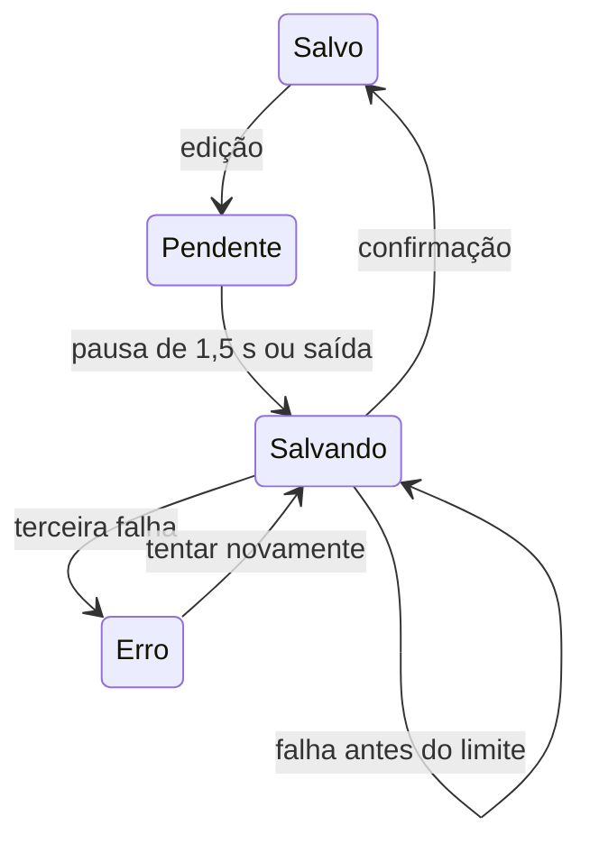

# Redesenho do Canvas Cósmico

| Campo | Valor |
| --- | --- |
| Data | 2026-11-07 |
| Solicitante e aprovador | Rechi |
| Status | Levantamento encerrado a pedido do usuário |
| Cobertura | Parcial; não declarar 100%. Decisões ainda abertas estão na seção 15; as fechadas em 2026-11-11, na seção 15.3 |
| Implementação deste redesenho | RF-06 e limite de nomes RN-08 implementados em 2026-11-08. Em 2026-11-10: regressão de ciclo na restauração de versões corrigida; medida de conteúdo das notas calculada e enviada pelo servidor; cena do simulador montada a partir dela. Em 2026-11-11: o espaço aberto de um contexto passou a ser desenhado e movido pela física, com soltura livre e fixação por Ctrl. Na mesma data a tela passou a ter só o canvas: raiz do vault como espaço, caminho no cabeçalho e ferramentas num painel flutuante (seção 15.4). Validado por testes locais e por uma conferência no navegador com uma única nota; arrasto, várias notas, gestos de toque e os demais itens seguem pendentes conforme a [rastreabilidade](canvas-cosmico-traceability.md) |
| Referência matemática | [Fórmulas e regras detalhadas](canvas-cosmico-formulas.md) |

## 1. Resumo

Redesenhar o Codex Noctarium para priorizar o espaço de conhecimento e uma navegação visual próxima do grafo do Obsidian. A visão inicial mostra universos como galáxias; o zoom revela constelações, planetas, continentes e níveis seguintes. Notas possuem conteúdo normal ou fluxograma, independentemente da representação cósmica. A distribuição usa orçamento espacial fixo, pesos de conteúdo e uma simulação de gravidade, elasticidade, contato e amortecimento.

Este documento consolida as decisões da entrevista. Complementa `crow-vault-canvas.md` e o planejamento de persistência no banco com criptografia. As decisões novas substituem as anteriores somente nos comportamentos explicitamente discutidos; não autorizam apagar trabalho existente ou alterar produção.

### 1.1 Objetivos

- Criar, editar, conectar e mover notas com os gestos e comandos definidos abaixo.
- Manter adaptação dinâmica mobile first, com nomes legíveis e seleção confortável.
- Preservar posições, fixações, subnotas e conexões nas operações aprovadas.
- Implementar autocomplete com no máximo cinco títulos, exclusivamente por prefixo.
- Salvar após 1,5 segundo de pausa, com limite de três tentativas em caso de falha.
- Metas numéricas de latência, quantidade de notas e desempenho da simulação não foram redefinidas nesta entrevista; validar a compatibilidade com as metas do documento anterior antes do desenvolvimento.

### 1.2 Situação atual

O usuário rejeitou a UI atual e solicitou simplificação e reorganização. Há desenvolvimento prévio local de correções de criação, integração com Rechi OS e protótipo de persistência de revisões criptografadas. Esse trabalho não constitui implementação do redesenho aqui especificado e precisa ser preservado e reconciliado com as branches existentes. A entrevista não executou validação funcional do produto.

## 2. Partes interessadas e usuários

| Persona | Quantidade | Precisa de | Pode | Não pode |
| --- | --- | --- | --- | --- |
| Rechi | Uso pessoal informado no documento anterior | Organizar e navegar conhecimento em desktop e celular | Aprovar requisitos e aceitar a entrega | A autorização desta entrevista não inclui publicação ou alteração do banco de produção |

O contexto de uso confirmado nesta entrevista inclui telas de tamanhos diferentes, mouse/teclado e toque. Novas personas, alterações de permissões e navegadores mínimos não foram discutidos. O modelo de autenticação existente é referência a verificar, não uma decisão técnica nova.

## 3. Modelo de negócio

O documento anterior descreve ferramenta pessoal sem cobrança. Esta entrevista não modificou esse modelo nem aprovou custos, planos ou serviços externos. Crescimento, custos operacionais e escala comercial não foram discutidos.

## 4. Regras de negócio

Responsável por todas as regras abaixo: Rechi. Fórmulas, definições e exemplos numéricos completos estão no anexo `canvas-cosmico-formulas.md`.

| ID | Regra | Exemplo | Exceção ou limite |
| --- | --- | --- | --- |
| RN-01 | Hierarquia cósmica navegada por zoom | Universo → constelação → planeta → continente | Nomes e aparência dos níveis posteriores não detalhados |
| RN-02 | Duplo clique vazio cria nota normal no nível atual; ponto circular cria uma nota irmã conectada | Dentro de um planeta, criar um continente | Tipo de conteúdo só muda ao editar; gestos por toque aprovados na seção 15.2 |
| RN-03 | Clique abre o conteúdo com expansão/aproximação; zoom manual navega pela hierarquia | Abrir o conteúdo de um planeta sem confundir com seus filhos | D-12: entra com 60% do menor lado da tela e sai com 30%; tempos de animação ainda abertos |
| RN-04 | Tamanho segue conteúdo e subnotas, dentro de orçamento fixo por nível | Adicionar planeta redistribui o espaço disponível | D-02/D-05: orçamento de tamanhos, grafo com pan/zoom e alvo de toque mínimo separado |
| RN-05 | Gravidade universal entre notas do mesmo espaço e Hooke nas conexões | Notas conectadas se mantêm mais próximas | Blocos internos do fluxograma não recebem essa física |
| RN-06 | Contato suave e amortecimento até estabilizar | Duas notas encostam e se empurram | Calibração inicial D-04 aprovada na seção 15.2 |
| RN-07 | Soltar livre acomoda; soltar com Ctrl fixa; posições e fixações são restauradas | Nota fixa atrai notas livres | Celular usa toque prolongado e menu “Fixar / Liberar” |
| RN-08 | Nome exibido tem até 20 caracteres do título, com “…” adicional se truncado | Nome longo fica abreviado no canvas | Valor completo permanece na nota e não é truncado no banco |
| RN-09 | Troca de tipo preserva descrição e pode converter o diagrama em bloco textual editável | Texto válido reconstrói o fluxograma | Estrutura inválida bloqueia; ausência de bloco cria diagrama vazio |
| RN-10 | Autosave após 1,5 segundo sem alterações; sair inicia salvamento imediato | Nova edição reinicia o prazo | Terceira falha cancela o ciclo, informa erro e oferece nova tentativa |
| RN-11 | Rascunho de reenvio fica apenas na memória da aba | Reenvio não perde conteúdo durante a sessão | Não recuperar após recarga; avisar sobre alterações pendentes ao fechar/recarregar |
| RN-12 | Pesquisa separa “Neste universo” de “Outros universos” | Resultado próximo aproxima; distante usa fade curto | Voltar restaura local, zoom e câmera anteriores |
| RN-13 | Mover pai leva subnotas e preserva relações externas | Conexões antigas continuam existindo | D-01/D-14: identidade e subespaço compartilhados; rejeitar ciclos; D-13: retirar uma participação sempre pergunta “só daqui” ou “de todos os lugares” |
| RN-14 | Notas externas aparecem discretamente nos cantos relativos; clique percorre o ancestral comum | Entre universos, recuar à visão inicial das galáxias e entrar no destino | Não usar a regra de fade da pesquisa para esse percurso |
| RN-15 | Comando de conexão oferece até cinco títulos que começam pelo texto digitado | `pla` encontra Planta, Planeta e similares | Sem correspondência de prefixo, não completar com títulos populares de outro início |
| RN-16 | Ordenação dos candidatos: pontuação decrescente, depois alfabética | Pontuação = acessos + pesquisas + links | D-09: eventos de contagem definidos na seção 15.3; títulos iguais mostram o caminho |
| RN-17 | Seeder de exemplos baseada nos projetos de Rechi | Universo “Meus Projetos” com projetos, documentação e tecnologias relacionadas | Execução local explícita, idempotente, sem sobrescrever edições ou semear produção |

### 4.1 Fórmulas de extrema importância

**As fórmulas são centrais e não podem ser silenciosamente substituídas.**

| Finalidade | Fórmula ou valor | Estado |
| --- | --- | --- |
| Texto | Letras/números × 1 + espaços/especiais × 0,4 | Confirmado; incluir Markdown e letras acentuadas como letras |
| Conteúdo próprio | `C = T + 0,8B + 0,8V + 0,4E` | Pesos complementares definidos por delegação do usuário |
| Conteúdo e subnotas | `Q = 0,5C + 0,8H` | H soma C dos descendentes únicos; D-01 aprovada |
| Orçamento espacial | `X = soma(Ai) + espaço vazio` | X fixo; reserva vazia com peso 2 |
| Distribuição | `Ai = (X − vazio) × wi / soma(w)` | D-02: X=1; wi=max(Qi,1); vazio=max(0,2; 2/(2+soma(w))) |
| Gravidade | `Fg = G × mi × mj / d²` | D-03/D-04: massa=Ai, distância entre centros, G=0,0001; mínimo numérico de distância 0,001 |
| Elasticidade | `Fe = k × (d − L)` | Hooke confirmado; quantidade de conexões reforça o componente elástico |
| Autocomplete | `S = acessos + pesquisas + links` | Soma com pesos unitários, após filtrar o prefixo |

`E` na fórmula do conteúdo representa ligações internas do fluxograma, não o espaço vazio. Consulte o anexo para evitar confusão entre os símbolos e conhecer os critérios de teste.

### 4.2 Ciclo de salvamento



A decisão D-08 foi aprovada em 2026-11-08: o ciclo manual reinicia o limite de três tentativas, e edições durante uma requisição ficam pendentes sem serem sobrescritas pela resposta. O diagrama não autoriza uma quarta tentativa automática no ciclo que falhou. Consulte a seção 15.1.

## 5. Requisitos funcionais

Todos os RF pertencem ao escopo solicitado; o usuário não definiu uma ordem de implementação por fase.

| ID | Descrição | Regras | Critério de aceite |
| --- | --- | --- | --- |
| RF-01 | Canvas cósmico e criação contextual | RN-01, RN-02 | Criar no espaço atual; pelo ponto circular, criar irmão conectado; vazio não cria conexão |
| RF-02 | Editor de nota em expansão no canvas | RN-03, RN-08 | Editar nome, cor, conteúdo, tipo e relacionamentos sem perder o contexto |
| RF-03 | Distribuição e física dinâmica | RN-04 a RN-07 | Aplicar as fórmulas aprovadas; contato suave; estabilizar e restaurar posições/fixações |
| RF-04 | Conteúdo normal ou fluxograma | RN-09 | Oferecer início/fim, processo, decisão, entrada/saída e setas com texto; blocos têm posição manual |
| RF-05 | Conversão textual do fluxograma | RN-09 | Usuário escolhe converter em texto ou apagar; reconstrução usa bloco ainda existente; erro bloqueia |
| RF-06 | Autosave e reenvio | RN-10, RN-11 | Prazo de 1,5 s; máximo de três tentativas; cache só em memória; erro com nova tentativa manual |
| RF-07 | Pesquisa pela rosa dos ventos | RN-12 | Ícone pequeno no canto inferior abre painel lateral flutuante inspirado em offcanvas |
| RF-08 | Movimentação hierárquica | RN-13 | Menu “Mover para…” seleciona destino e leva todas as subnotas |
| RF-09 | Conexões externas navegáveis | RN-14 | Exibir nos cantos com menor opacidade e navegar pelo ancestral comum |
| RF-10 | Conectar por comando | RN-15, RN-16 | `/link` e `/l` (D-09: `$l` foi retirado) oferecem seleção de até cinco títulos por prefixo e criam a conexão escolhida |
| RF-11 | Seeder do universo pessoal de projetos | RN-17 | Criar uma hierarquia navegável com exemplos de notas, documentação, tecnologias, fluxogramas e conexões; reexecutar sem duplicar nem sobrescrever conteúdo editado |

### 5.1 Seeder “Meus Projetos”

Incluir na implementação uma seeder local, explicitamente acionada, que cria o universo **“Meus Projetos”**. Ela oferece conteúdo útil para testar a visualização, não só notas vazias. Organizar constelações como categorias de projetos, planetas como projetos e continentes/subnotas como documentação e tecnologias; os nomes de categorias abaixo são organização de demonstração, não uma classificação obrigatória dos dados reais do usuário.

| Categoria de exemplo | Projeto | Exemplos de conteúdo |
| --- | --- | --- |
| Ecossistema Crow | Codex Noctarium | Visão geral, modelo de notas, regras matemáticas, navegação, tecnologias e fluxograma de salvamento |
| Aplicações pessoais | Rechi OS | Visão geral, integração com o Vault, navegação e tecnologias confirmadas nos manifests |
| Inteligência artificial | E.R.I.S. | Identidade do projeto, documentação e tecnologias apenas conforme fontes disponíveis do próprio projeto |
| Projetos afetivos | Memorial Salem | Propósito e documentação técnica disponível; detalhes pessoais adicionais não devem ser inventados |

Usar os projetos já identificados na conversa como inventário inicial, não como uma lista supostamente completa de todos os repositórios. Antes de gerar documentação técnica de um projeto, ler seus arquivos e manifests quando disponíveis. Para Codex Noctarium e Rechi OS, Laravel/PHP e React/TypeScript são exemplos sustentados pelo código local e documentação existente; nomes e versões exatas devem vir das fontes consultadas na implementação. Projetos sem fonte local disponível podem receber uma visão geral baseada nos fatos fornecidos pelo usuário e uma indicação de documentação técnica pendente, sem inventar funcionalidades ou status.

Requisitos da seeder:

- Criar exemplos de nota normal e fluxograma válido, descrição, nomes longos e conexões entre projetos/documentação/tecnologias.
- Incluir conexões externas entre espaços distintos para testar indicações nos cantos e percurso pelo ancestral comum. Notas sobre a mesma tecnologia podem ser relacionadas sem duplicar artificialmente seu conteúdo como se fossem projetos diferentes.
- Documentar a origem do conteúdo de exemplo; distinguir descrição real de fluxo ilustrativo. Não afirmar que um recurso planejado já está implementado.
- Semear o fluxograma de salvamento com a pausa de 1,5 segundo e o limite de três tentativas, conforme este levantamento.
- Usar identificadores de fixture estáveis para que uma reexecução não crie universos, notas, relações ou diagramas duplicados. Não depender só do título, pois ele pode ser editado ou repetido.
- Preservar alterações manuais nas notas existentes e não recriar automaticamente conteúdo de exemplo que o usuário tenha excluído sem uma operação explícita de reposição. A política de reposição precisa ser documentada na implementação.
- Criar dados pelo caminho de persistência do produto, respeitando escopo do usuário, validação e criptografia configurada; não gerar um armazenamento paralelo em arquivos.
- Não inserir chaves, tokens, credenciais, dados de produção ou trechos privados sem relação com o exemplo. Não acessar banco de produção para descobrir os projetos.
- Não inventar métricas reais de uso: contadores começam sem histórico fictício. Fixtures especiais para testar ranking, se necessárias, devem estar identificadas como dados sintéticos de teste.
- Disponibilizar instruções do comando de execução local e um resumo do que foi criado ou já existia. Não executar automaticamente em produção nem embutir a carga em migrações.

Em um host local com o pacote habilitado, aplique as migrações e inicialize o vault antes de carregar os exemplos.

```bash
php artisan migrate
php artisan cvc:initialize
php artisan cvc:seed-projects
```

O comando aceita os ambientes Laravel `local` e `testing` e informa as quantidades de notas e ligações criadas e de itens preservados ou ignorados. Cada item recebe um identificador persistente por vault. Reexecutar o comando preserva as edições e as exclusões. A carga não oferece reposição automática. Para recuperar os exemplos completos, use um vault local novo e isolado. A tabela de identificadores deve acompanhar os dados em backups e restaurações. Reverter sua migração remove os identificadores e preserva as notas já criadas, então reaplicá-la e executar a carga novamente pode duplicar exemplos.

As notas do Noctarium e do Rechi OS usam o README, os manifests e o levantamento do Canvas Cósmico como fontes. O fluxograma ilustra a política RF-06/D-08. A documentação técnica de E.R.I.S. e Memorial Salem fica pendente.

## 6. Requisitos não funcionais

| ID | Categoria | Requisito | Verificação |
| --- | --- | --- | --- |
| RNF-01 | Responsividade | Mobile first e adaptação dinâmica | Testar toque e mouse em tamanhos de tela distintos, sem sobreposição dos controles |
| RNF-02 | Legibilidade | Nota vazia selecionável confortavelmente; nome abreviado legível | D-05: área de toque mínima de 44×44 px; seleção por títulos quando alvos coincidirem |
| RNF-03 | Segurança | Não persistir rascunho no navegador | Ausência de conteúdo pendente em localStorage, sessionStorage, IndexedDB e cache persistente |
| RNF-04 | Integridade | Não indicar salvo antes da confirmação | Testar lentidão, três falhas e retomada manual |
| RNF-05 | Estabilidade | Simulação dissipa movimento | Testar contato, repouso, fixação e ausência de valores inválidos |
| RNF-06 | Limites de UI | Cinco sugestões e 20 caracteres de nome | Verificações explícitas de limite e truncamento |

Carga-alvo, concorrência, disponibilidade, conformidade e nível formal de acessibilidade não foram definidos nesta entrevista. Não declará-los atendidos sem validação.

## 7. Modelo de domínio e dados

### 7.1 Entidades

Modelo conceitual, não uma migração aprovada:

| Entidade | Atributos necessários ao comportamento | Origem | Volume |
| --- | --- | --- | --- |
| Nota | Identidade, título, tipo de conteúdo, descrição/conteúdo, cor | Edição no Vault | Não discutido |
| Participação hierárquica | Nota, espaço pai, caminho | Organização no Vault | Não discutido |
| Relação | Origem, destino | Ponto circular, edição ou comando | Não discutido |
| Estado visual | Posição, fixação, câmera e zoom conforme contexto | Interação no canvas | Não discutido |
| Fluxograma | Nós, ligações, textos e posições manuais | Editor ou bloco textual válido | Não discutido |
| Contadores | Acessos, pesquisas e links do destino | Eventos ainda a definir | Não discutido |
| Rascunho pendente | Conteúdo e estado de envio | Memória da aba | Não persistente |

### 7.2 Relacionamentos

Pai possui subnotas; mover o pai leva o conjunto. Relações conectam notas inclusive entre universos. D-01/D-14 aprovadas no desenvolvimento: cada documento mantém sua identidade e recebe um espaço próprio de subnotas; aparições compartilham conteúdo e subnotas, com posição/fixação independentes. A política de mover/retirar uma participação ainda precisa respeitar esse modelo; não impor árvore exclusiva.

### 7.3 Histórico, retenção e migração

Posições e fixações precisam ser restauradas. A reconstrução de fluxograma depende do bloco textual restante; recuperação de bloco apagado pelo histórico não foi aprovada nesta conversa. Retenção de revisões, lixeira e alcance da criptografia foram decididos em 2026-11-11 (seção 15.3). Migração do layout atual, conversão dos dados existentes e o desenho de chaves permanecem abertos.

## 8. Arquitetura

### 8.1 Visão geral

A entrevista especifica comportamento, sem escolher nova arquitetura ou biblioteca de canvas. Simulação visual, editor, fila de salvamento em memória e persistência precisam ser reconciliados com a implementação existente. Autorização, validação e acesso ao banco não podem ser considerados substituídos pelos controles da interface.

### 8.2 Tecnologias

| Camada | Referência existente | Decisão desta entrevista |
| --- | --- | --- |
| Aplicação | Pacote Laravel/React no Rechi OS, conforme documento anterior | Nenhuma troca de stack autorizada |
| Interface | Canvas e editor existentes | Novo comportamento especificado; biblioteca não escolhida |
| Painel lateral | Bootstrap offcanvas | Referência visual, não adoção obrigatória do Bootstrap |
| Banco e criptografia | Planejamento e protótipo anteriores | Continuar trabalho autorizado; solução final precisa ser validada |

### 8.3 Integrações

| Sistema | Direção | Gatilho | Contrato | Se falhar |
| --- | --- | --- | --- | --- |
| Rechi OS ↔ Vault | Bidirecional | Entrada e retorno ao ambiente | Integração existente a verificar | Tratamento ainda não detalhado nesta entrevista |
| Interface → persistência | Gravação | Pausa ou saída da nota | Contrato HTTP final não definido aqui | Até três tentativas e rascunho em memória |

### 8.4 Multiempresa, ambientes e deploy

Nenhuma alteração de multiempresa foi solicitada. Usuário quer testar localmente e confirmou MAIN como origem de referência; preservar e conciliar branches mais recentes antes de desenvolver. Não alterar banco de produção. Publicação, push e PR não estão autorizados por este encerramento.

## 9. Fluxos principais

1. **Captura:** entrar no espaço desejado; duplo clique no vazio cria nota normal; ponto circular cria irmã conectada. Criar no contexto errado é falha.
2. **Edição e envio:** abrir conteúdo por clique; editar; após pausa de 1,5 s salvar; ao sair antecipar o envio. Falhas preservam o rascunho em memória; terceira falha para e informa erro.
3. **Conversão:** escolher tipo; texto anterior vira descrição; na volta escolher converter ou apagar. Bloco válido reconstrói; inválido impede conversão; ausente cria fluxograma vazio.
4. **Busca:** abrir rosa dos ventos; visualizar grupos separados; selecionar resultado; aproximar ou aplicar fade conforme distância; voltar restaura câmera.
5. **Conexão por comando:** digitar comando e prefixo; filtrar; ordenar; limitar cinco; identificar destino pelo título e caminho; selecionar e conectar. Sem prefixo correspondente, não oferecer título de outro início.
6. **Movimentação e vínculo externo:** selecionar “Mover para…”; escolher destino; levar descendentes; preservar conexões externas. Clicar na indicação percorre o ancestral comum; entre universos passa pela visão das galáxias.

O ciclo com erro está representado na seção 4.2. Tempos de animação, cancelamento durante movimentação e falhas de navegação ainda não foram detalhados.

## 10. Gargalos, riscos e mitigações

| Risco | Onde | Probabilidade | Impacto | Encaminhamento |
| --- | --- | --- | --- | --- |
| Orçamento fixo incompatível com mínimos legíveis | Muitos filhos, especialmente no celular | Não medida | Impede exibição utilizável | Definir política antes da implementação da distribuição |
| Instabilidade ou custo da simulação | Gravidade, colisões e quantidade de nós | Não medida | Movimento ruim ou travamento | Definir unidades, singularidades, constantes e carga de benchmark |
| Perda de rascunho não enviado | Recarga ou encerramento da aba | Condicional à falha de envio | Perda de alterações | Aviso de saída; sem prometer durabilidade inexistente |
| Contradições com dados existentes | Pais, participações e layout | Não medida | Perda de relações ou pesos incorretos | Conciliar modelo antes de migrar; não apagar trabalho |
| Cache ou métricas expõem conteúdo | Persistência local e contadores | Não medida | Quebra de privacidade | Respeitar cache só em memória e definir métricas autorizadas no servidor |

## 11. Escopo e fases

O escopo aprovado inclui RF-01 a RF-11, incluindo a seeder pessoal de demonstração. A aparência cósmica pode começar básica e ser refinada depois, conforme solicitado. A ordem técnica de entrega, o corte mínimo de uma fase e o cronograma não foram fechados; não afirmar que uma priorização foi aprovada. Persistência local durável de rascunhos foi explicitamente descartada. Implementação e testes serão trabalho posterior a este levantamento.

## 12. Engenharia e operação

Repositórios: `CaiqueRechi/crow-vault-canvas` e `CaiqueRechi/rechi-os`. Seguir convenções existentes: preservar trabalho, branch cm- de main atualizada para desenvolvimento, sem subagentes, commits lógicos em inglês sem coautoria, documentação separada, sem push. Esta entrevista não cria branch nem commit.

Testes futuros precisam abranger unidades matemáticas, regras de contexto, endpoints autorizados, interface e navegação por mouse/toque. Os exemplos de caracteres, pesos e autocomplete no anexo são dados de aceite. Reenvio, persistência e fluxogramas exigem cenários de erro, não apenas fluxo feliz.

CI/CD, monitoramento, backup, suporte e plano de implantação não foram redefinidos. A verificação desta entrega documental não equivale a executar a suíte do produto nem comprova que o ambiente local está funcionando.

## 13. Restrições

Não foi definido prazo ou orçamento adicional. Não perder trabalho das branches existentes, não alterar produção e não publicar. Segurança orientou a rejeição do cache persistente. Não escolher silenciosamente novos pesos centrais, fórmulas ou regras que contrariem as decisões; os pesos complementares do conteúdo foram expressamente delegados e estão identificados no anexo.

## 14. Aceite

Rechi aceita a implementação após testar os fluxos definidos. A confirmação do exemplo visual aprova a interpretação do autocomplete, não comprova um recurso implementado no Vault.

Evidências necessárias: criação no contexto correto; edição e movimentação sem perdas; fórmulas verificadas; distribuição responsiva; fixação/restauração; conversões válidas e inválidas; três falhas de envio sem quarta tentativa; ausência de rascunho persistente; pesquisa/retorno; conexão externa pelo ancestral; autocomplete exclusivamente por prefixo.

Para `pla`, o exemplo usa Planta, Planeta, Plantera, Plancton e Placebo. Laranja, Foguete, Tangerina e Atlas dos planetas não são elegíveis, ainda que tenham maior pontuação. Testar menos de cinco correspondências, títulos iguais e empate de pontuação.

Para a seeder, verificar em banco local isolado: primeira execução cria o universo e seu conteúdo; segunda execução não duplica registros; renomear/editar uma nota e reexecutar preserva a edição; notas possuem tipos e relações corretos; fluxograma pode ser aberto e convertido; documentação identifica exemplos; carga respeita a persistência criptografada quando configurada. Verificar também que a execução não seleciona banco de produção nem inclui credenciais nos dados semeados.

## 15. Decisões em aberto

Em 2026-11-11 Rechi fechou D-07, D-09, D-10 e D-11 e a maior parte de D-12 a D-15; as decisões estão na seção 15.3. Os pontos abaixo continuam **não discutidos ou parcialmente discutidos**, não aprovados por suposição. Responsável: Rechi; prazo: não definido. Devem ser resolvidos quando bloquearem a fase correspondente.

| # | Decisão | Área | Impacto |
| --- | --- | --- | --- |
| D-12 (parte restante) | Tempos de animação do zoom e cancelamento durante a movimentação | Interação | Completar transições |
| D-13 (parte restante) | Migração do layout atual e conversão dos dados existentes | Dados | Necessária antes de mudar o esquema dos dados atuais |
| D-14 (parte restante) | Integração final com o Rechi OS; desenho de chaves: derivação, troca de senha e guarda da cópia do administrador | Integração | Bloqueia a implementação da criptografia e qualquer hospedagem remota |
| D-15 (parte restante) | Ambientes, operação e custos | Entrega | Planejamento de implantação ainda necessário |

As demais áreas do checklist não redefinidas nesta entrevista conservam referências anteriores como contexto a verificar; não contam automaticamente como novas confirmações. Não declarar 100% de cobertura nem testes de produto concluídos.

### 15.1 D-08 — Política de salvamento aprovada em 2026-11-08

Rechi aprovou nesta conversa de desenvolvimento:

- Pausa de 1,5 segundo desde a última edição para iniciar o autosave.
- Falhas de rede e respostas HTTP transitórias (408, 425, 429 e 5xx) permitem nova tentativa após 1,5 segundo, até três tentativas totais por ciclo.
- Conflitos de revisão e falhas de autorização/sessão param imediatamente; não sobrescrever nem reabrir automaticamente para trocar a revisão esperada. Outras rejeições não transitórias também encerram o ciclo.
- “Tentar novamente” inicia um ciclo manual novo com até três tentativas. Editar após um ciclo falho não reinicia os envios automáticos.
- Apenas uma requisição de salvamento por vez na aba. A resposta confirma somente o conteúdo enviado; texto digitado durante o envio continua pendente e usa a revisão confirmada no próximo envio.
- Sair da nota inicia salvamento imediato e aguarda todas as alterações pendentes. Falha mantém o editor aberto; após erro, a navegação não reinicia automaticamente um ciclo.
- Rascunhos e fila ficam somente na memória da aba. Fechar/recarregar solicita o aviso do navegador enquanto houver alteração sem confirmação; não promete recuperação após recarga.
- Voltar ao conteúdo antigo depois de falha não comprova persistência: o estado de erro e o aviso de saída continuam até nova confirmação.

O desenvolvimento pode seguir automaticamente para outras fases, conforme autorização posterior de Rechi, preservando os bloqueios de decisões em aberto e a necessidade de consentimento específico para dependências.

A implementação usa o endpoint existente `PATCH /vault/documents/{id}`, enviando `content` e a revisão esperada em `revision`. Uma resposta bem-sucedida precisa confirmar a mesma identidade, o conteúdo enviado e uma revisão numérica mais recente. A rastreabilidade e os limites de validação estão em `canvas-cosmico-traceability.md`.

### 15.2 Decisões matemáticas, visuais e de domínio aprovadas em 2026-11-08

- **D-01:** H é a soma do conteúdo próprio C de todos os descendentes, contando cada identidade uma vez no espaço avaliado. Q=0,5C+0,8H; não aplicar 0,8 novamente a cada profundidade. Rejeitar ciclos e referências ausentes.
- **D-02:** orçamento lógico X=1. Cada filho recebe wi=max(Qi,1). Reserva E=max(0,2X; X×2/(2+soma(w))). Ai=(X−E)×wi/soma(w). Sem filhos, E=X. A implementação verifica conservação numérica com tolerância absoluta de 1e-12.
- **D-03:** Ai é área circular; raio=sqrt(Ai/π), massa=Ai, distância entre centros. k efetivo=k×quantidade de conexões do par; L=soma dos raios+folga configurável.
- **D-04:** calibração inicial configurável G=0,0001; k=0,2; folga=0,04; contato F=32×sobreposição; amortecimento v×exp(−6dt); integração em passos de 1/120 s, com avanço limitado a 1/15 s; distância mínima numérica 0,001; repouso após velocidade inferior a 0,0001 durante 0,5 s. Posição fixa não muda e continua exercendo forças. Coincidência de centros recebe direção determinística pelos IDs. O coeficiente de contato inicialmente aprovado em 20 foi corrigido para 32 com aprovação explícita após uma verificação isolada mostrar aprisionamento de duas notas grandes coincidentes.
- **D-05:** X limita a soma dos tamanhos, não exige confinamento dos círculos numa região fechada de mesma área. Grafo pode se espalhar com pan/zoom. Alvo de toque mínimo 44×44 px, independente de Ai. Sobreposição de alvos oferece os títulos para seleção. Não esconder nomes por falta de espaço nem reduzir indefinidamente os alvos.
- **D-06:** uma unidade lógica equivale a 1024 unidades do canvas. Posições existentes permanecem na convenção atual; a física converte durante o cálculo. Redimensionar preserva centro observado e zoom, ajustando somente a translação; posições e fixações não mudam por causa da tela.
- **D-14 (modelo):** documentos mantêm identidade/conteúdo e recebem espaço próprio de subnotas. Nota compartilhada mantém o mesmo conteúdo e subnotas em todas as aparições, com posições/fixações por espaço. Contextos existentes são preservados e podem receber conteúdo ao editar. Evolução do esquema será aditiva e reversível, verificada em banco local com rollback. Isso não declara a criptografia completa nem autoriza produção.
- **D-12 (gestos):** no celular, toque prolongado no vazio abre “Nova nota” naquele ponto; toque simples numa nota abre o conteúdo; toque no ponto circular cria uma irmã conectada; toque prolongado na nota abre “Fixar / Liberar”. No desktop, manter duplo clique vazio para criar, clique para editar e Ctrl ao soltar para fixar. A aprovação define comportamento; a integração visual ainda está pendente.

Estas aprovações definem contratos; não são evidência de que a simulação, as migrações ou a interface já estejam implementadas. Consulte os estados e resultados na rastreabilidade.

### 15.3 Decisões aprovadas em 2026-11-11

Rechi respondeu a cada ponto nesta data. Três itens foram propostos por quem registrou e confirmados por ele na mesma data: o destino das subnotas compartilhadas, o das versões na exclusão definitiva e a ausência de cache na soma de descendentes. Nada desta seção está implementado.

**D-07 — Bloco textual do fluxograma (RF-04, RF-05)**

- Formato: bloco de código `mermaid` com um subconjunto de flowchart (início/fim, processo, decisão, entrada/saída e setas com texto), mais linhas de comentário que guardam a posição manual de cada bloco.
- Mais de um bloco de fluxograma na nota: a conversão é bloqueada e o erro pede que reste apenas um.
- Depois de reconstruir o diagrama, o bloco sai da descrição; o restante do texto é preservado.
- Persistência: nós, ligações, textos e posições em JSON no próprio documento, salvos e versionados junto com a nota. Não há tabelas próprias de blocos.

**D-09 — Autocomplete de conexão (RF-10)**

- Acesso = cada abertura do conteúdo da nota.
- Pesquisa = cada vez que a nota é escolhida num resultado da rosa dos ventos. Aparecer na lista sem ser escolhida não conta.
- Links = quantidade de conexões que a nota tem no momento; diminui quando uma conexão é removida.
- O prefixo é comparado sem diferenciar maiúsculas e acentos; espaços iniciais são descartados.
- Comandos aceitos: somente `/link` e `/l`. O `$l`, aceito no exemplo visual da entrevista, foi retirado, e `$link` não existe.

**D-10 — Conexões externas (RF-09)**

- Cada conexão externa vai para o canto mais próximo da direção do destino.
- Um canto mostra até 3 indicações; acima disso, um contador “+N” abre a lista.
- As indicações ficam presas à tela e não participam da física.

**D-11 — Pesquisa (RF-07)**

- Perto = resultado no espaço aberto no momento: a câmera se aproxima.
- Longe = qualquer outro lugar: fade de 300 ms, 150 ms para escurecer e 150 ms para clarear.
- Na visão das galáxias, sem universo aberto: lista única com o caminho de cada resultado, sem o grupo “Neste universo”; a seleção sempre usa fade.

**D-12 — Zoom hierárquico e conexões no editor (RF-01, RF-02)**

- O zoom entra no espaço de uma nota quando ela ocupa 60% do menor lado da tela e sai quando o espaço atual encolhe para 30%. A folga entre os limiares evita alternar de nível com o zoom parado.
- O editor mostra a lista de conexões da nota, com remover em cada uma e um campo “Conectar a…” que usa o mesmo autocomplete por prefixo. O comando no texto continua valendo.

**D-13 — Exclusão, lixeira e histórico (RF-08)**

- Excluir uma nota com subnotas pergunta se as subnotas também devem ser excluídas. Se sim, o conjunto vai para a lixeira. Se não, a exclusão não acontece: o usuário retira as subnotas antes.
- Retirar uma nota que aparece em mais de um espaço sempre pergunta: “só daqui” ou “de todos os lugares”.
- Lixeira: exclusão definitiva automática após 7 dias.
- Histórico: todas as versões são mantidas.
- Subnotas que também aparecem em outro espaço continuam vivas lá quando o conjunto vai para a lixeira.
- As versões de uma nota são apagadas junto com ela na exclusão definitiva.

**D-14 — Criptografia**

- Ponta a ponta, com chave do usuário, cifrando só o conteúdo: corpo, versões e fluxograma são cifrados no navegador.
- Títulos e a medida numérica de conteúdo ficam legíveis no servidor. Pesquisa e `/link` por título continuam no servidor; pesquisa dentro do conteúdo deixa de existir no servidor.
- Recuperação: o código de recuperação é oferecido no início da configuração; se for perdido, é solicitado ao administrador (Rechi).

Consequências sobre o que já está implementado:

- A medida de conteúdo passa a ser calculada no navegador e enviada como número; o servidor não consegue mais conferi-la contra o texto. Isso substitui a decisão da fase 7 da rastreabilidade.
- `cvc:measure-documents` e a medição na restauração de versão não funcionam sobre conteúdo cifrado; cada versão precisa guardar a própria medida.
- O conteúdo que já existe em claro precisa de uma conversão feita pelo navegador.
- Para o administrador reemitir o código, o servidor precisa guardar uma cópia recuperável da chave. O administrador, portanto, tem como ler o conteúdo: a proteção vale contra vazamento do banco, não contra o administrador.

**D-15 — Volume, limites e ordem de entrega**

- Volume-alvo: até 5.000 notas por vault.
- Limite do conteúdo no salvamento: 5 MB por nota; acima disso o servidor recusa. Com todas as versões mantidas, o banco não tem teto de crescimento.
- A soma de descendentes segue sem cache; ele só entra se a medição nesse volume mostrar lentidão.
- Ordem de entrega depois da parte visível do RF-03:
  1. RF-01 criação e zoom, RF-02 editor.
  2. RF-07 pesquisa, RF-10 `/link`, RF-09 conexões externas.
  3. RF-08 mover e exclusão/lixeira.
  4. RF-04 e RF-05 fluxograma.
  5. Criptografia.
  6. RF-11 seeder.

### 15.4 Decisões de interface aprovadas em 2026-11-11

Rechi viu a primeira etapa no navegador e decidiu:

- Sai da tela tudo o que não é o canvas: os cartões, o explorador da esquerda e a coluna da direita. A raiz do vault também é um espaço cósmico, com os universos como círculos.
- As funções das duas colunas (explorador e criação de contexto, estado operacional, busca, lixeira, perspectivas e versões, propriedades, anexos e relações) continuam no produto, num painel lateral flutuante aberto por um ícone. Nenhuma foi removida do backend.
- O canvas não tem fundo pontilhado.
- Não há botão de criar nota. A nota é criada com duplo clique num ponto vazio do espaço, como já dizia a RN-02, e nasce nesse ponto. Na raiz do vault o duplo clique não cria nada, porque a raiz só contém universos.
- O zoom do canvas não tem limite perceptível. A biblioteca exige limites finitos; ficaram em 1% e 10000%, fora do alcance de qualquer espaço do orçamento.

Decisão de implementação, não de produto: ao entrar num espaço a câmera o enquadra inteiro, sem passar de 200% de zoom. Isso não substitui a navegação por zoom da D-12, que continua por fazer.

### 15.5 Estilo e paleta aprovados em 2026-11-12

Rechi pediu uma identidade visual própria do vault, independente da do Rechi OS, e escolheu entre seis direções a **F, Rapinante cósmico**, inspirada na skin Cosmic Reaver Kassadin (as fontes divergem entre roxo e dourado e azul, branco e dourado; a paleta é uma interpretação, não uma cópia).

| Nome | Valor | Papel |
| --- | --- | --- |
| Fenda | `#090714` | Fundo |
| Manto | `#130F2C` / `#1E1747` | Superfícies |
| Vazio | `#7B5CFF` | Linhas, ligações, destaque |
| Energia | `#CFE3FF` | Foco e seleção |
| Champanhe | `#EBCB86` | Acabamento: borda das notas, caminho, rótulos |

- Tipografia: Cinzel no caminho e nos rótulos, Manrope na interface e nas notas, JetBrains Mono no editor e nos estados. Fontes servidas pelo pacote, porque a CSP do Rechi OS só aceita fontes da própria origem.
- Assinatura: toda nota tem borda fina champanhe; a nota em foco ganha a energia branco-azulada com halo violeta.
- Separação do Rechi OS: fundo azul-preto em vez de ameixa, violeta vivo em vez de roxo apagado, champanhe claro em vez de mostarda, nenhum laranja.

## 16. Glossário

| Termo | Significado |
| --- | --- |
| Universo/constelação/planeta/continente | Representações dos espaços e níveis hierárquicos |
| Tipo de conteúdo | Nota normal ou fluxograma, independente do nível cósmico |
| Irmã | Nota criada no mesmo espaço que a nota de origem |
| Ancestral comum mais próximo | Primeiro espaço hierárquico que contém os dois caminhos |
| Nota externa | Destino relacionado pertencente a outro espaço |
| Prefixo | Caracteres iniciais do título iguais ao texto digitado |
| Rascunho em cache | Alterações pendentes só na memória da aba |
| Fixação | Impede deslocamento da nota, mantendo sua influência gravitacional |
| X | Orçamento total fixo do espaço visual de um nível |
